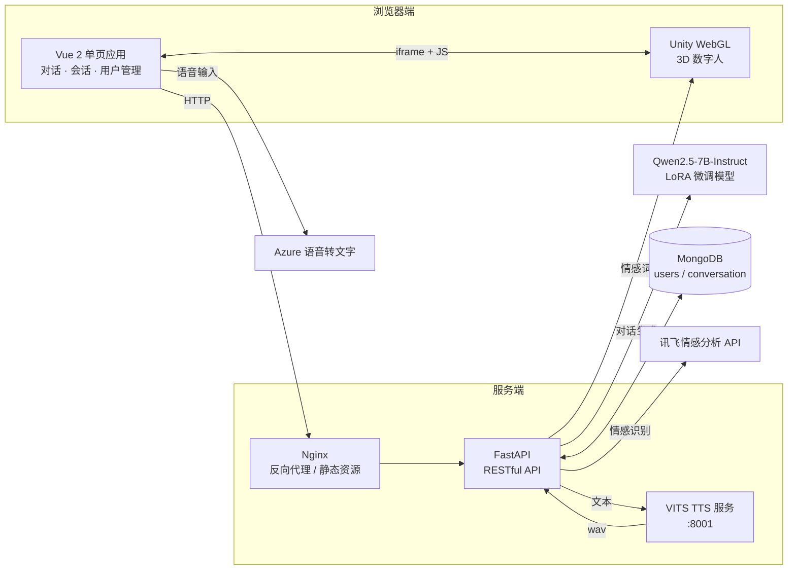
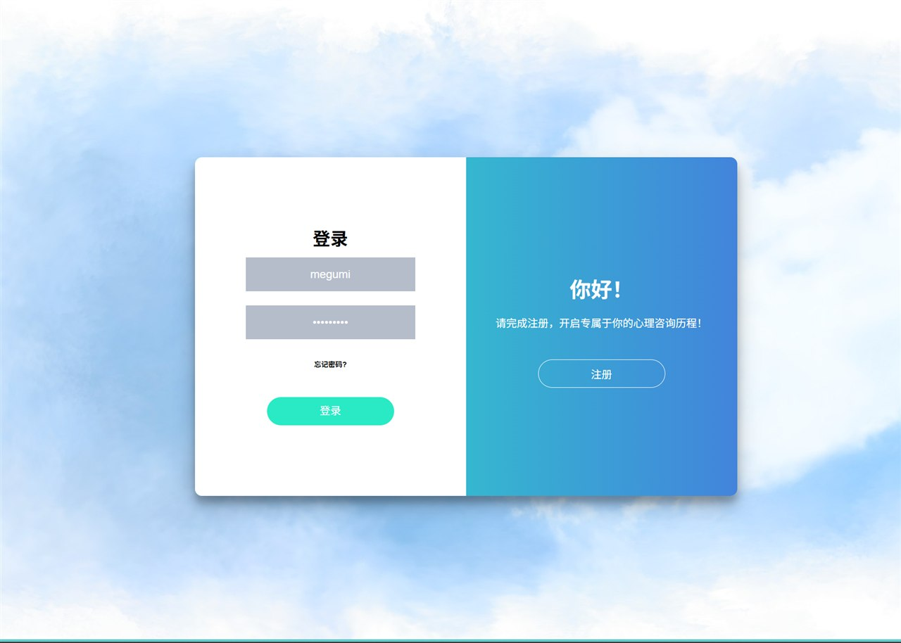
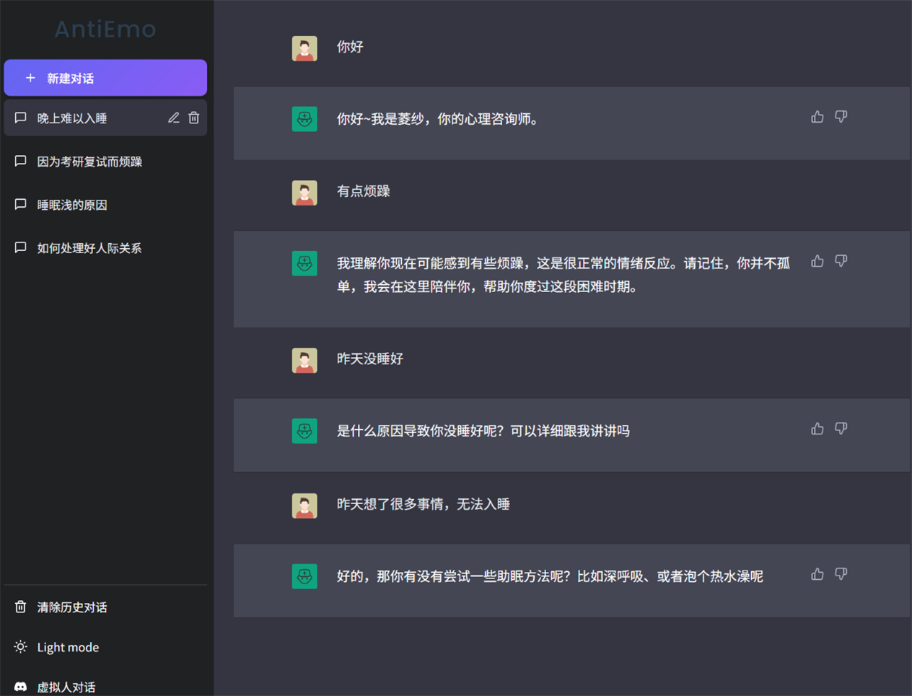
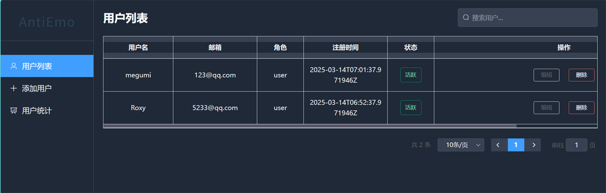
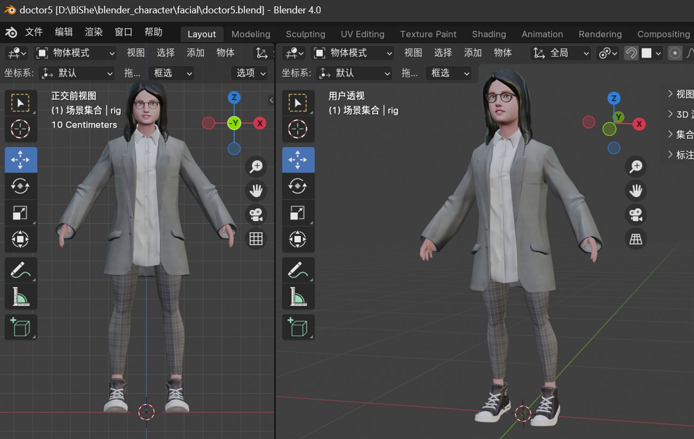

<div align="center">

# 🩺 AntiEmo

### 基于情感智能的虚拟医生心理咨询系统

**Design and Implementation of an Emotionally Intelligent Virtual Doctor Psychological Counseling System**


*「你好，我是菱纱。」—— 一个会倾听、会共情，也有表情的虚拟心理咨询师*

</div>

---

## 📖 项目简介

心理健康服务长期面临**资源不足、专业人才短缺、时间与地域受限**等问题。与此同时，大语言模型在语义理解与情感陪伴方面展现出巨大潜力。

AntiEmo 是一套完整的**虚拟医生心理咨询系统**：以 **Qwen2.5-7B-Instruct** 为底座，通过 **LoRA** 在心理咨询对话数据上进行高效微调，使模型学会「主动倾听 → 开放式提问 → 渐进式干预」的咨询策略；再结合 **VITS 语音合成**与 **Unity 3D 数字人**，让虚拟医生不仅能「说对话」，还能「有声音、有表情」。

系统采用前后端分离架构，支持文本对话与数字人视频对话两种模式，并实现了会话管理、情绪识别、用户与权限管理等完整业务闭环。

## ✨ 核心功能

| 模块 | 能力 |
| :--- | :--- |
| 💬 **共情对话** | 基于心理咨询数据微调的大模型，以开放式提问引导用户自我觉察，回复简洁、克制、有共情 |
| 🎭 **数字人交互** | Unity WebGL 数字人嵌入前端页面，伴随语音播放口型与肢体动画，并根据用户情绪切换面部表情 |
| 🗣️ **情感语音合成** | VITS 微调专属音色，将模型回复实时合成为自然语音 |
| 😊 **情绪感知** | 调用讯飞情感分析 API 得到褒义 / 中性 / 贬义等指标，用于驱动数字人表情 |
| 📚 **会话管理** | 新建、切换、删除会话，自动生成对话标题，历史记录持久化到 MongoDB |
| 👤 **用户体系** | 注册 / 登录、随机盐值 + SHA-256 密码哈希、Token 鉴权，管理员用户管理与 ECharts 数据统计 |
| 🔒 **安全兜底** | 检测极端词并对处于危险状态的用户给出心理援助热线提示 |

## 🏗️ 系统架构

系统采用 **B/S** 模式与四层软件架构（表示层 / 通讯层 / 服务层 / 数据层）：



## 🧠 关键技术实现

### 1. 心理咨询大模型微调

**数据准备**

- 以开源心理健康对话数据集 **EmoLLM** 为基础，融合真实心理咨询对话与多模型生成的模拟对话；
- 覆盖焦虑、抑郁、压力管理、家庭关系、教育成长、职场发展等多类主题；
- 规模约 **1,500 条对话、7,000 轮交互**，统一整理为 `instruction / input / output` 的 JSON 格式；
- 额外构造约 **100 条「自我认知」对话**，让模型稳定保持「心理医生」的身份设定，缓解多轮对话中的身份遗忘。

**微调配置**

在 AutoDL 算力云平台上使用 **LLaMA-Factory** 对 Qwen2.5-7B-Instruct 进行 LoRA 微调：

| 参数 | 设置 | 说明 |
| :--- | :--- | :--- |
| `finetuning_type` | `lora` | 参数高效微调 |
| `lora_rank` | `8` | 低秩矩阵的秩 |
| `learning_rate` | `1e-4` | LoRA 微调常用初始学习率 |
| `num_train_epochs` | `3` | 训练轮次 |
| `gradient_accumulation_steps` | `8` | 等效扩大 batch size |
| `cutoff_len` | `1024` | 最大输入序列长度 |
| `bf16` | `true` | 混合精度训练，节省显存 |

> 环境：2 × NVIDIA RTX 4090 (24 GB) · PyTorch 2.3.1 · CUDA 12.1 · Ubuntu 22.04

**微调效果**

| 维度 | 原始模型 | LoRA 微调后 |
| :--- | :--- | :--- |
| 提问方式 | 直接给出 3 条通用建议 | 4 次开放式提问，引导用户表达 |
| 回复长度 | 100+ 词，信息密度高 | 每轮 20–30 字，符合对话节奏 |
| 干预策略 | 单向输出建议 | 由易到难、分步骤的渐进式干预 |
| 上下文延续 | 忽略用户反馈 | 根据用户反馈动态调整 |

微调后的模型不再「说教」，而是更像一位真正在倾听的咨询师。

### 2. 数字虚拟人

- **语音合成**：基于 **VITS-fast-fine-tuning**，精选约 **70 条 5–10 秒的干净人声干声**，经 `slicer-gui` 切分后微调，得到稳定、自然的专属音色；
- **模型与绑定**：从 ReadyPlayerMe 获取带骨骼与面部蒙皮的 3D 模型，在 **Blender** 中完成身体骨骼绑定（自动绑骨插件）与面部绑定（FaceIt），并制作口型、表情关键帧动画；
- **实时驱动**：模型以 FBX 导入 **Unity**，编写 C# 通信逻辑后导出 **WebGL**，通过 `<iframe>` 嵌入前端，用 JavaScript 传递情感标签与播放指令。

### 3. 后端服务（FastAPI）

| 方法 | 接口 | 功能 |
| :--- | :--- | :--- |
| `POST` | `/register` | 用户注册（用户名唯一性校验、盐值 + SHA-256 加密） |
| `POST` | `/login` | 登录校验并返回会话信息 |
| `POST` | `/chat` | 调用大模型生成回复，可选调用 VITS 合成语音 |
| `GET` | `/generate/id` | 生成新的会话 ID |
| `GET` | `/chat/title/{session_id}` | 根据前两轮对话自动生成会话标题 |
| `GET` | `/history/{username}/{session_id}` | 查询指定会话的历史记录 |
| `GET` | `/getAll_history/{username}` | 查询用户全部对话 |
| `GET` | `/get_users` | 管理员查看用户列表 |
| `POST` | `/get_user` | 查询单个用户信息 |

对话记录以 JSON 文档形式存储在 MongoDB 的 `conversation` 集合中，按 `username + session_id` 归档，天然契合多轮对话的数据结构。

### 4. 前端（Vue 2）

- **Vue 2 + Vue Router + Vuex + Element UI** 构建单页应用，Axios 对接后端；
- 对话页支持 Markdown 渲染、代码高亮、新建 / 切换 / 删除会话、Light mode；
- 数字人页面通过 `<iframe>` 加载 Unity WebGL，并与其进行消息通信；
- 管理端使用 **ECharts** 展示用户增长与活跃度统计。

## 📸 界面展示

| 登录 / 注册 | 文本对话 |
| :---: | :---: |
|  |  |

| 用户管理 | Blender 骨骼绑定 |
| :---: | :---: |
|  |  |

## 🚀 快速开始

> 仓库 `main` 分支存放项目文档与设计资料，`backend` / `frontend` 分支存放对应模块的示例代码。

**环境要求**：Python 3.10+、Node.js 16+、MongoDB 5.0+，以及可用的 DashScope API Key。

```bash
# 1. 启动 MongoDB（默认 27017 端口）

# 2. 启动后端对话服务
cd backend/LLM
pip install fastapi uvicorn pymongo dashscope requests
export DASHSCOPE_API_KEY="your-api-key"     # Windows: set DASHSCOPE_API_KEY=...
python -m uvicorn main:app --host 0.0.0.0 --port 8000

# 3. 启动 VITS 语音服务
cd backend/TTS/VITS_fast_fine_tuning
pip install -r requirements.txt
python vits_service.py                      # http://localhost:8001

# 4. 启动前端
cd frontend
npm install
npm run serve
```

默认前端地址为 `http://localhost:8080`，后端接口为 `http://localhost:8000`。

## 📂 项目结构

```text
AntiEmo/
├── backend/
│   ├── LLM/                  # FastAPI 对话、用户、会话接口
│   └── TTS/
│       └── VITS_fast_fine_tuning/   # VITS 微调与推理服务
├── frontend/                 # Vue 2 前端（登录、对话、数字人、用户管理）
├── docs/
│   └── images/               # README 截图
└── README.md
```

## ⚠️ 说明

- 本项目仅用于学习与研究，**不能替代专业心理诊断与治疗**；
- 数字人演示版本在前端使用预渲染视频进行口型/表情播放，Unity 工程、WebGL 构建产物与模型权重因体积原因未随仓库提供；
- 语音模型基于少量公开语音素材微调，仅供个人学习，请勿用于商业用途；
- 运行前请将代码中的 API Key、数据库地址等敏感配置替换为环境变量，并妥善保管自己的密钥；
- 系统中部分组件参考/使用了以下优秀开源项目，在此致谢：[EmoLLM](https://github.com/SmartFlowAI/EmoLLM)、[LLaMA-Factory](https://github.com/hiyouga/LLaMA-Factory)、[VITS-fast-fine-tuning](https://github.com/Plachtaa/VITS-fast-fine-tuning)、[Qwen](https://github.com/QwenLM/Qwen2.5)、[SoulChat](https://github.com/scutcyr/SoulChat)、[SmileChat](https://github.com/qiuhuachuan/smile)。

---

<div align="center">

如果这个项目对你有帮助，欢迎点一个 ⭐️

</div>
